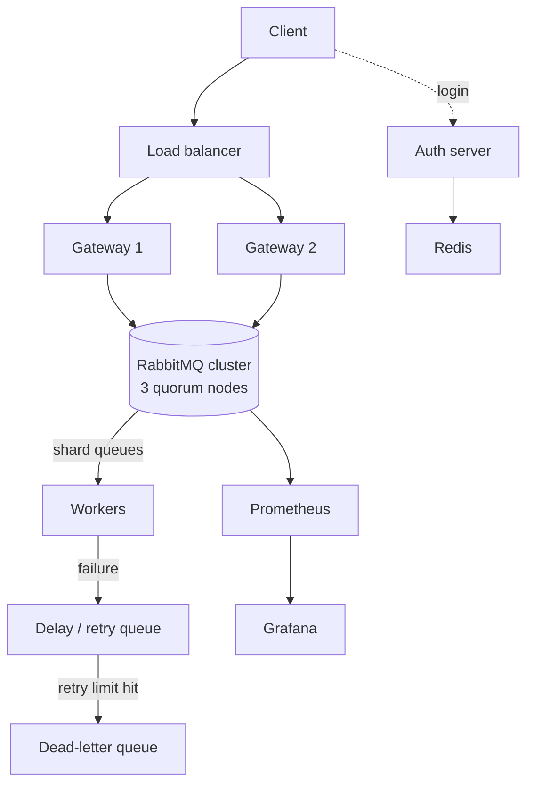

# Distributed Messaging System with RabbitMQ

A task-processing system in Go built on a 3-node RabbitMQ cluster. Clients log in with Google, send tasks through a load-balanced HTTP gateway, and workers pick them up from sharded quorum queues. Failed tasks are retried with a delay and end up in a dead-letter queue after too many failures.

I built this to learn how message brokers behave under failure: what happens when a node dies, when a worker crashes mid-task, or when one client floods the system.

## What it does

- **3-node RabbitMQ cluster with quorum queues.** Queues are replicated with Raft, so losing one node does not lose messages. A recovery handler watches the cluster and restarts nodes that drop out.
- **Gateway + load balancer.** Each gateway starts on a free port and registers itself with the load balancer, which health-checks gateways and removes dead ones.
- **Sharded routing.** The gateway hashes each task to a shard queue, so work spreads evenly across workers.
- **All four exchange types.** Direct, topic, fanout and headers exchanges, each with its own producer and consumer.
- **Retries and dead letters.** Failed tasks go to a delay queue and are retried. After the retry limit they move to a DLQ for inspection.
- **Rate limiting.** Per-API-key limits (10 requests a minute) backed by Redis.
- **Login.** Google OAuth2. The auth server issues a JWT, and Redis caches the token.
- **Metrics.** Queue depth, DLQ depth, live workers, publish/ack counts and task latency, exported for Prometheus. A Grafana dashboard is in `monitor/`.

## Architecture



## Project layout

```
cmd/
  auth_server/       Google login, issues JWTs (port 9000)
  auth_worker/       handles login requests from the queue
  client/            CLI client: logs in and submits tasks
  load_balancer/     routes requests to healthy gateways
  gateway_consumer/  sample consumer for gateway messages
  resilient/         consumer that survives broker restarts
  flood/             load generator for testing rate limits
  testing_shards/    sends tasks to check shard distribution
gateway/             HTTP gateway (registers with the load balancer)
dead_letter_queues/  retry + DLQ producers and workers
direct_exchange/ topic_exchange/ headers_exchange/ pubsub/
work_queue_model/    work queue producer and workers
quorum_recovery/     watches cluster health and recovers nodes
limiter/             Redis rate limiter
monitor/             Prometheus metrics + Grafana dashboard
```

## Running it

You need Go 1.23+ and Docker.

```bash
# 3-node RabbitMQ cluster
docker-compose up -d

# Redis for rate limiting and token cache
docker run -d -p 6379:6379 redis

# Google OAuth credentials and a JWT signing key
export GOOGLE_CLIENT_ID=...
export GOOGLE_CLIENT_SECRET=...
export JWT_SECRET=$(openssl rand -hex 32)

go run ./cmd/auth_server
go run ./cmd/auth_worker
go run ./cmd/load_balancer
go run ./gateway          # start two or more for load balancing
go run ./cmd/client       # log in and send tasks
```

To try the failure handling, stop one RabbitMQ container while tasks are flowing (`docker stop <node>`) and watch the quorum recovery logs, or run `go run ./cmd/flood` to hit the rate limiter.
